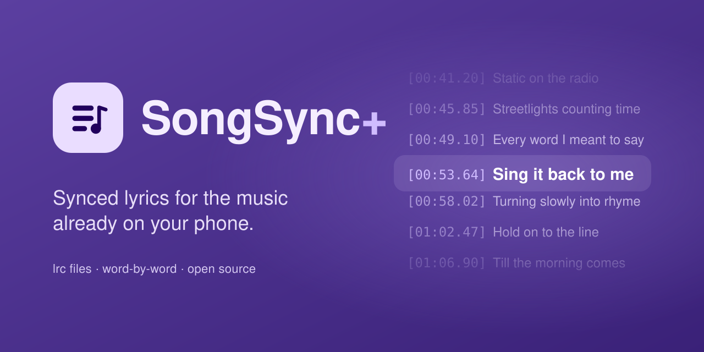

An Android app that finds synced lyrics (.lrc files) for the music already on your phone and saves them next to your songs.

SongSync+ is a fork of [SongSync](https://github.com/Lambada10/SongSync). It installs alongside the original (package `me.mobihack.songsyncplus`).

### Features

- **Whole library in one tap:** download lyrics for every song at once, or pick songs one by one
- **Many lyrics providers:** pick the one that works best for your music
- **Automatic fallback:** if one provider has nothing, the next one is tried, in the default order or your own
- **Better matches:** uses the track's duration to pick the right result and prefers the exact title over tagged versions
- **Word-by-word lyrics:** from providers that have them, including separate voices for duets
- **Clean lyrics:** strips songwriter credits, metadata and section labels
- **Save or embed:** write an .lrc file next to the song, or embed the lyrics in the audio file
- **Now playing:** shows the song playing on your phone and gets its lyrics in one tap (needs notification access)
- **Poweramp plugin:** answers Poweramp's lyrics requests with your providers
- **Music folders:** include only some folders, or ignore some
- **Proxy support:** route provider requests through an HTTP or SOCKS proxy
- **Search:** find lyrics for songs that aren't in your library, and save them
- **Material 3 Expressive design:** follows your wallpaper colours, with light, dark and pure-black themes

### Installation

Download the latest version from the [releases page](https://github.com/mobihack/SongSync/releases), or add it to [Obtainium](https://github.com/ImranR98/Obtainium) to get updates automatically:

Requires Android 7.0 (API 24) or newer.

### Translation

Translations live in `app/src/main/res/values-*/strings.xml`. To add or improve one, open a [pull request](https://github.com/mobihack/SongSync/pulls).

### Issues

Found a bug or have an idea? [Open an issue](https://github.com/mobihack/SongSync/issues).

### Thanks to SongSync

SongSync+ is built on [SongSync](https://github.com/Lambada10/SongSync) by [Lambada10](https://github.com/Lambada10) and its contributors. Everything up to version 4.3.3 is their work: library scanning, lyrics downloading and embedding, the original providers, and the translations from the SongSync community on Weblate. Thank you for building it and for releasing it as free software.

### License

This project is licensed under the GNU General Public License v3.0. See the [LICENSE](LICENSE) file for details.
